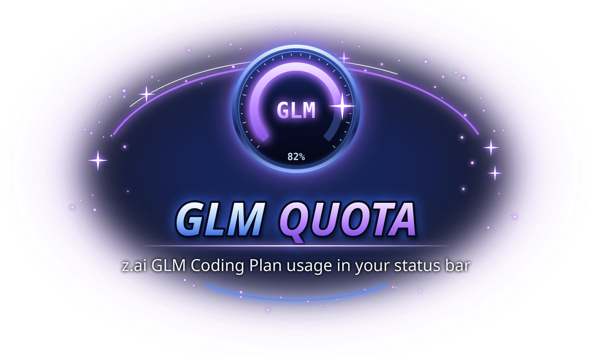

<p align="center"></p>

# GLM Quota

Show z.ai GLM Coding Plan quota usage in the VS Code status bar.

## Install

Requires VS Code 1.74.0 or newer. Download **zai-quota-0.7.0.vsix** from the
[EVILE project page](https://evile.uk/redesign/projects/glm-quota/).

1. Open **Extensions → … → Install from VSIX…**.
2. Select the downloaded file.
3. Run **Developer: Reload Window** if the extension has not appeared.

Or install from a terminal:

```sh
code --install-extension zai-quota-0.7.0.vsix
```

Show your z.ai GLM Coding Plan quota usage in the VS Code status bar.

```
$(zap) GLM 5h 63% · W 81% · R 3/2
```

Percentages mean **remaining** quota. If the account has purchased credits, the response's `CREDIT_LIMIT` entry shows up as an extra `C 87%` segment (plus a "Purchased credits" section in the tooltip); it never affects the color bands, which stay driven by the 5h/weekly windows.

When the account has quota-reset packs available, an `R 3/2` segment shows how many 5-hour and weekly packs you can use. The tooltip lists each kind with its next expiry and the time of the last reset. Apply a pack from the z.ai usage page.

## How it works

Unlike the Codex companion extension (which talks to the local `codex` CLI), z.ai has no local CLI or documented quota API. This extension therefore calls the coding-plan usage endpoint directly:

```
GET https://api.z.ai/api/monitor/usage/quota/limit
Authorization: Bearer <your z.ai API key>
```

Reset packs come from a second endpoint on the same host, read on each refresh:

```
GET https://api.z.ai/api/biz/customer-package-reset/list?targetType=PERSONAL
```

If that read fails, the quota windows still show and the reset segment is left out.

The host is set by `zaiQuota.host` (`api.z.ai` or `open.bigmodel.cn`). The key is sent only to that host; there is no fallback to the other one. Only the focused VS Code window polls; other windows catch up when they regain focus.

Both endpoints are **undocumented** and may change without notice. Failures are logged using fixed reason codes, not raw responses or server messages.

## Setup

1. Install the extension, then run **GLM Quota: Set API Key** (or click the status bar item).
2. Paste your z.ai API key (GLM Coding Plan). It is stored in VS Code **secret storage**, outside `settings.json`, files and logs.
3. The status bar shows remaining quota for the 5-hour and weekly windows.

Create your key at [z.ai API Keys](https://z.ai/manage-apikey/apikey-list).

## Settings

| Setting | Default | Description |
| --- | --- | --- |
| `zaiQuota.host` | `api.z.ai` | Usage endpoint host: `api.z.ai` (international) or `open.bigmodel.cn` (mainland China). Pick the one your key was issued by. |
| `zaiQuota.refreshIntervalSeconds` | `60` | Refresh interval in seconds (minimum 15). |
| `zaiQuota.thresholds` | `{ "redBelowPercent": 10, "amberBelowPercent": 30 }` | Color bands: below `redBelowPercent` → red tint, below `amberBelowPercent` → amber tint, otherwise green text. |
| `zaiQuota.mcp.enabled` | `false` | Lets coding agents read this quota through the MCP server. Toggle it from the link at the foot of the status bar tooltip. |

## Security / privacy design

This extension **does**:

- store your z.ai API key in VS Code secret storage (`context.secrets`)
- send that key only to the configured host (`zaiQuota.host`, default `api.z.ai`) over HTTPS, as a bearer token for the usage query
- show the returned quota numbers in the status bar

This extension **does not**:

- write the key to settings, workspace files, or logs
- send the key anywhere except the configured host
- read workspace files, Codex/GLM session files, or credentials of other tools
- send telemetry
- execute model prompts (the usage endpoint is read-only and consumes no quota)

## Commands

- `GLM Quota: Refresh`: refresh now (clicking the status item does this; if no key is set it prompts for one)
- `GLM Quota: Open Usage Page`: open the z.ai usage page ([z.ai/manage-apikey/coding-plan/personal/usage](https://z.ai/manage-apikey/coding-plan/personal/usage)) in your browser; double-clicking the status item does this
- `GLM Quota: Toggle MCP Server`: turn the MCP server for coding agents on or off; the link at the foot of the tooltip does the same
- `GLM Quota: Set API Key`: set/replace the key
- `GLM Quota: Clear API Key`: remove the key and stored state

## Troubleshooting

- `$(key) GLM ?`: no API key set, or the key was rejected; click the item or run `GLM Quota: Set API Key`.
- `$(warning) GLM ?`: last refresh failed; hover for the reason. If your key is from BigModel, set `zaiQuota.host` to `open.bigmodel.cn`.
- The `GLM Quota` output channel (View → Output) shows sanitized success/failure lines and fixed failure reason codes, never server-returned error text.
- If `5h`/`W` numbers look stale after resuming from sleep, click the item to refresh.

## Privacy and workspace trust

`zaiQuota.host` is machine-scoped. Set it in **User settings**, not project settings. Only `api.z.ai` and `open.bigmodel.cn` are allowed; redirects are not followed. Your key is sent only to the selected host over HTTPS.
No telemetry is sent by this extension. Review provider-specific credential
handling above. Never include keys, tokens or account responses in bug reports.

## Licence

Copyright © 2026 Richard Beech / 1larity. User-owned code, documentation and assets
are licensed under [Creative Commons Attribution-NonCommercial-ShareAlike 4.0
International](https://creativecommons.org/licenses/by-nc-sa/4.0/)
(**CC BY-NC-SA 4.0**). Credit the author and source, link the licence, indicate
changes, use non-commercially and share adaptations under the same licence.
Third-party material retains its own terms; previous licence grants are not revoked.
See [LICENSE](LICENSE) for the legal text.

## JSON command line for coding agents

`glm-quota` prints the quota shown in the status bar as one JSON document, so an
agent can check its own limits before starting long work.

```sh
node cli.js --pretty        # from the extension folder
npx . --pretty              # or install the glm-quota command: npm link
```

Fields: `ok`, `provider`, `plan`, `band` (`green`, `amber` or `red`, from the
most constrained window), `status` (the status bar text) and `windows[]` with
`kind`, `label`, `usedPercent`, `remainingPercent`, `resetAt` (ISO 8601) and
`resetsInSeconds`. `credits` describes purchased credits and `resets` the available reset packs.
When the quota cannot be read, `ok` is `false`, `error.reason` and
`error.message` say why, and the exit code is 1. The key is read from `ZAI_API_KEY`, or from the output of `ZAI_API_KEY_COMMAND` (for example `secret-tool lookup service zai account api`); `ZAI_HOST` selects the API host.

### All installed quota extensions in one document

`glm-quota --all` collates the quota of every installed Claude, Codex and GLM
quota extension into one JSON document: `providers` holds each extension's
own document keyed by `claude`, `codex` or `glm`, and `summary` gives the
worst `band` and the `tightest` window across them. Extensions that are not
installed are left out, and a provider that fails shows `ok: false` without
affecting the others. The exit code is 0 when at least one provider answered.

Each extension records the location of its `cli.js` in
`~/.config/quota-monitor/` (`$XDG_CONFIG_HOME`, `$QUOTA_MONITOR_DIR` or
`%APPDATA%` where set) when it activates or its CLI runs. Any one installed
extension can therefore produce the combined view.

## MCP server for coding agents

`mcp.js` is a Model Context Protocol server (stdio) with two read-only tools:

- `get_quota` returns one provider's document, the same one the command line prints. `provider` picks `claude`, `codex` or `glm` and defaults to `glm`.
- `get_all_quotas` returns the combined document of `--all`.

The server is off by default. Turn it on with the link at the foot of the status bar tooltip, the **GLM Quota: Toggle MCP Server** command, or the `zaiQuota.mcp.enabled` setting. Each provider answers only while its own extension's toggle is on; otherwise its document has `ok: false` and `error.reason` `mcp-disabled`. A change applies from the next tool call, with no agent restart.

While it is on, VS Code 1.101 and later list the server under their MCP servers, running with this extension's own settings and credentials. Other agents start it with `node <folder>/mcp.js`, where `<folder>` is this extension's folder or a source checkout. The installed folder name includes the version, so a source checkout gives a path that survives updates. Outside VS Code the key comes from `ZAI_API_KEY_COMMAND`, a command that prints it (such as a keyring lookup), so the agent config names a command rather than holding the key. `ZAI_API_KEY` also works, and `ZAI_HOST` selects the API host.

```sh
# Claude Code
claude mcp add -s user quota -e ZAI_API_KEY_COMMAND='secret-tool lookup service zai account api' -- node <folder>/mcp.js
```

```toml
# Codex: ~/.codex/config.toml
[mcp_servers.quota]
command = "node"
args = ["<folder>/mcp.js"]
env = { ZAI_API_KEY_COMMAND = "secret-tool lookup service zai account api" }
```

```jsonc
// Kilo: ~/.config/kilo/kilo.jsonc
"mcp": { "quota": { "type": "local", "command": ["node", "<folder>/mcp.js"], "environment": { "ZAI_API_KEY_COMMAND": "secret-tool lookup service zai account api" }, "enabled": true } }
```

Any one server reports all installed providers, so one entry per agent is enough. Give that entry `ZAI_API_KEY_COMMAND` so GLM can answer through it too.

## Developer guide

The extension is plain CommonJS JavaScript with **no runtime npm dependencies**
and no compilation step. Use Node.js 22+ for development.

```sh
npm test
node --check extension.js
npx --yes @vscode/vsce@4.0.0 package --no-dependencies
```

Open the checkout in VS Code and press **F5** to launch an Extension Development
Host. Run `npm test` for the offline test suite.

- `extension.js`: VS Code integration.
- `lib/`: provider clients, parsers and monitor lifecycle.
- `test/`: offline regression coverage.
- `.vscodeignore`: files included in the extension package.

See [SECURITY.md](SECURITY.md) for sensitive reporting guidance.
