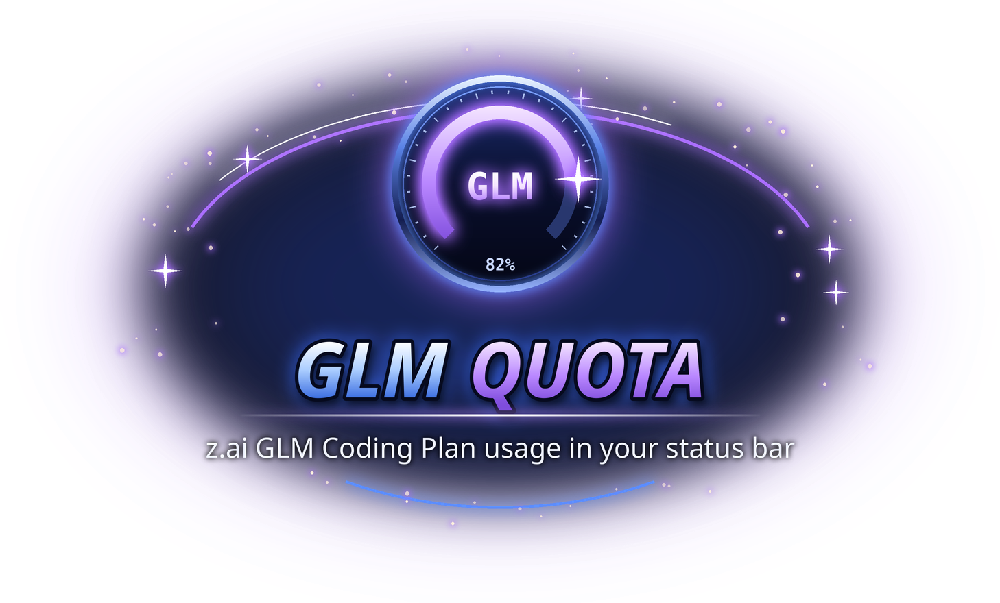

<p align="center"></p>

# GLM Quota

Show z.ai GLM Coding Plan quota usage in the VS Code status bar.

## Install

Requires VS Code 1.74.0 or newer. Download **zai-quota-0.5.2.vsix** from the
[EVILE project page](https://evile.uk/redesign/projects/glm-quota/).

1. Open **Extensions → … → Install from VSIX…**.
2. Select the downloaded file.
3. Run **Developer: Reload Window** if the extension has not appeared.

Or install from a terminal:

```sh
code --install-extension zai-quota-0.5.2.vsix
```

Show your z.ai GLM Coding Plan quota usage in the VS Code status bar.

```
$(zap) GLM 5h 63% · W 81%
```

Percentages mean **remaining** quota. If the account has purchased credits, the response's `CREDIT_LIMIT` entry shows up as an extra `C 87%` segment (plus a "Purchased credits" section in the tooltip); it never affects the color bands, which stay driven by the 5h/weekly windows.

## How it works

Unlike the Codex companion extension (which talks to the local `codex` CLI), z.ai has no local CLI or documented quota API. This extension therefore calls the coding-plan usage endpoint directly:

```
GET https://api.z.ai/api/monitor/usage/quota/limit
Authorization: Bearer <your z.ai API key>
```

The host is set by `zaiQuota.host` (`api.z.ai` or `open.bigmodel.cn`). The key is sent only to that host; there is no fallback to the other one. Only the focused VS Code window polls; other windows catch up when they regain focus.

The endpoint is **undocumented** and may change without notice. Failures are logged using fixed reason codes, not raw responses or server messages.

## Setup

1. Install the extension, then run **GLM Quota: Set API Key** (or click the status bar item).
2. Paste your z.ai API key (GLM Coding Plan). It is stored in VS Code **secret storage** — never in `settings.json`, files, or logs.
3. The status bar shows remaining quota for the 5-hour and weekly windows.

Create your key at [z.ai API Keys](https://z.ai/manage-apikey/apikey-list).

## Settings

| Setting | Default | Description |
| --- | --- | --- |
| `zaiQuota.host` | `api.z.ai` | Usage endpoint host: `api.z.ai` (international) or `open.bigmodel.cn` (mainland China). Pick the one your key was issued by. |
| `zaiQuota.refreshIntervalSeconds` | `60` | Refresh interval in seconds (minimum 15). |
| `zaiQuota.thresholds` | `{ "redBelowPercent": 10, "amberBelowPercent": 30 }` | Color bands: below `redBelowPercent` → red tint, below `amberBelowPercent` → amber tint, otherwise green text. |

## Security / privacy design

This extension **does**:

- store your z.ai API key in VS Code secret storage (`context.secrets`)
- send that key only to the configured host (`zaiQuota.host`, default `api.z.ai`) over HTTPS, as a bearer token for the usage query
- show the returned quota numbers in the status bar

This extension **does not**:

- write the key to settings, workspace files, or logs
- send the key anywhere except the configured host
- read workspace files, Codex/GLM session files, or credentials of other tools
- send telemetry
- execute model prompts (the usage endpoint is read-only and consumes no quota)

## Commands

- `GLM Quota: Refresh` — refresh now (clicking the status item does this; if no key is set it prompts for one)
- `GLM Quota: Open Usage Page` — open the z.ai usage page ([z.ai/manage-apikey/usage](https://z.ai/manage-apikey/usage)) in your browser; double-clicking the status item does this
- `GLM Quota: Set API Key` — set/replace the key
- `GLM Quota: Clear API Key` — remove the key and stored state

## Troubleshooting

- `$(key) GLM ?` — no API key set, or the key was rejected; click the item or run `GLM Quota: Set API Key`.
- `$(warning) GLM ?` — last refresh failed; hover for the reason. If your key is from BigModel, set `zaiQuota.host` to `open.bigmodel.cn`.
- The `GLM Quota` output channel (View → Output) shows sanitized success/failure lines and fixed failure reason codes, never server-returned error text.
- If `5h`/`W` numbers look stale after resuming from sleep, click the item to refresh.

## Privacy and workspace trust

`zaiQuota.host` is machine-scoped. Set it in **User settings**, not project settings. Only `api.z.ai` and `open.bigmodel.cn` are allowed; redirects are not followed. Your key is sent only to the selected host over HTTPS.
No telemetry is sent by this extension. Review provider-specific credential
handling above. Never include keys, tokens or account responses in bug reports.

## Licence

Copyright © 2026 Richard Beech / 1larity. User-owned code, documentation and assets
are licensed under [Creative Commons Attribution-NonCommercial-ShareAlike 4.0
International](https://creativecommons.org/licenses/by-nc-sa/4.0/)
(**CC BY-NC-SA 4.0**). Credit the author and source, link the licence, indicate
changes, use non-commercially and share adaptations under the same licence.
Third-party material retains its own terms; previous licence grants are not revoked.
See [LICENSE](LICENSE) for the legal text.

## Developer guide

The extension is plain CommonJS JavaScript with **no runtime npm dependencies**
and no compilation step. Use Node.js 22+ for development.

```sh
npm test
node --check extension.js
npx --yes @vscode/vsce@4.0.0 package --no-dependencies
```

Open the checkout in VS Code and press **F5** to launch an Extension Development
Host. Tests run locally with synthetic fixtures; they do not prove live provider
availability or interactive UI acceptance.

- `extension.js`: VS Code integration.
- `lib/` (quota monitors): provider clients, parsers and monitor lifecycle.
- `test/`: offline regression coverage.
- `.vscodeignore`: package allow-list; excludes tests, screenshots, credentials,
  local editor settings, source artwork and previous VSIX files.

See [SECURITY.md](SECURITY.md) for sensitive reporting guidance.
